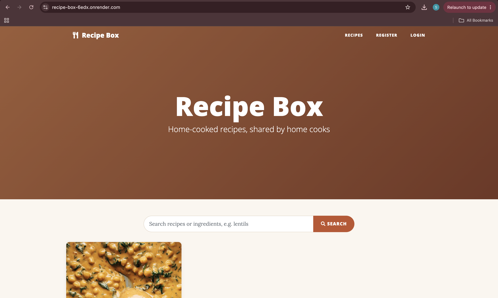
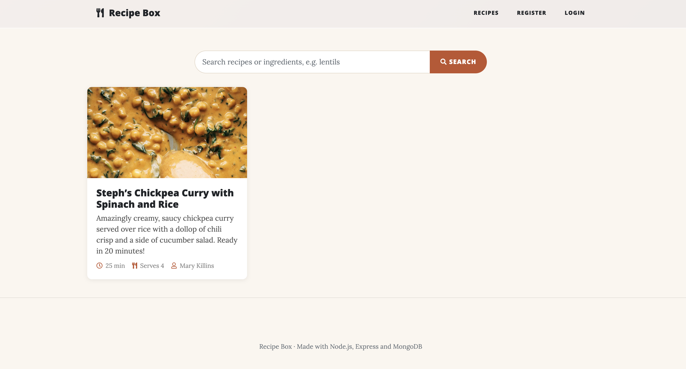
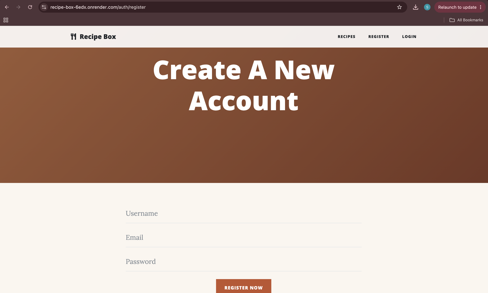
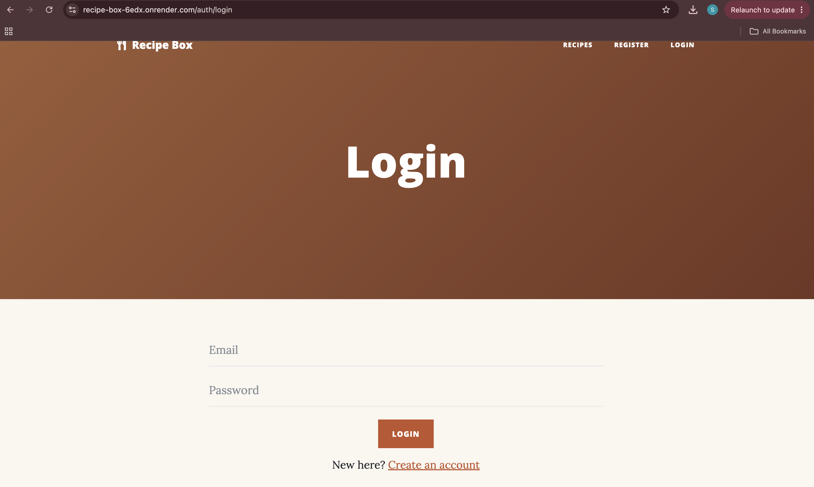

# Recipe Box

A multi-user recipe sharing site built with **Node.js, Express and MongoDB**. Visitors can browse recipes; registered users can log in and share their own, with ingredients, step-by-step method, cooking times and a photo of the dish.

I first built this in 2019 as a general blog, and in 2026 updated it to run on current Node.js and reworked it into a recipe site (details below).

**Live demo:** https://recipe-box-6edx.onrender.com/ (hosted on Render's free tier, so the first load may take up to a minute while the server wakes up)

## Screenshots





| Register | Login |
| --- | --- |
|  |  |

## Features

- **User accounts**: registration and login, with passwords hashed using bcrypt
- **Sessions**: login sessions are stored in MongoDB, so they survive server restarts
- **Form validation**: registration errors (missing fields, an email that is already taken) are shown back to the user with their input kept
- **Protected routes**: only logged-in users can share recipes, and logged-in users are redirected away from the login and register pages
- **Structured recipes**: each recipe stores its ingredients and method steps as lists, plus prep time, cook time, servings and a photo. Total time is calculated automatically
- **Search**: find recipes by name, description or ingredient. Matching is case-insensitive, every word must match, and results have a shareable URL (`/?q=lentils`)
- **Recipe form validation**: missing fields are reported back with friendly messages, and everything the user typed is kept so they don't lose their work
- **Image uploads**: photos are uploaded to Cloudinary, or saved to the server's disk if Cloudinary isn't configured
- **Author tracking**: every recipe is linked to the user who shared it
- **Server-rendered pages**: built with the Edge template engine and Bootstrap, with a card grid of recipes on the home page, custom warm styling, and a 404 page for unknown routes
- **Safe output**: all user content is HTML-escaped when displayed, so users can't inject scripts into the page

## Tech stack

| Area | Technology |
| --- | --- |
| Runtime and server | Node.js, Express 5 |
| Database | MongoDB with Mongoose (hosted on MongoDB Atlas) |
| Authentication | bcrypt, express-session, connect-mongo |
| Views | Edge templates, Bootstrap |
| File uploads | express-fileupload, Cloudinary |

## How the code is organised

```
index.js        App setup and all routes
controllers/    One file per route (home page, view recipe, new recipe, register, login, logout)
middleware/     auth (requires login), redirectIfAuthenticated, validateRecipe (checks and cleans the recipe form)
database/models/ Mongoose schemas for User and Recipe
views/          Edge templates, with a shared layout
public/         CSS (including recipes.css for the custom theme), JavaScript and images
```

Each route maps to its own small controller, and access rules live in reusable middleware rather than inside the controllers.

## 2026 update

### From blog to recipe site

- Replaced the free-text blog post with a structured `Recipe` model (ingredients, steps, times, servings)
- Redesigned the pages: a photo card grid on the home page, a recipe page with quick facts, an ingredient list and numbered method, and a warmer colour scheme
- Removed the rich-text editor, which saved raw HTML and allowed script injection, in favour of plain, escaped fields
- Moved to RESTful routes (`GET /recipes/new`, `POST /recipes`, `GET /recipes/:id`)

### Modernising the code

I brought the original 2019 code up to date so it runs on Node.js 24:

- Upgraded all dependencies to current major versions (Express 4 → 5, Mongoose 5 → 9, bcrypt 3 → 6, connect-mongo 3 → 6, Cloudinary 1 → 2)
- Rewrote the database code from callbacks to `async/await`, since current Mongoose no longer supports callbacks
- Fixed bugs from the original version:
  - every post got the same creation date (the date the server started)
  - flash messages failed because they were set up before the session
  - an invalid post URL crashed the request instead of showing a 404 page
  - two uploads with the same file name overwrote each other
  - the database connection string, including its password, was printed to the log on startup
- Made Cloudinary optional and added sensible defaults, so the app can run locally without any accounts
- Added an `.env.example` file documenting every setting

## Running locally

Requires Node.js 18 or newer and a MongoDB database (local, Docker or MongoDB Atlas).

```bash
npm install
cp .env.example .env     # then set DB_URI and EXPRESS_SESSION_KEY
npm run dev
```

Then open http://localhost:4000 (or the `PORT` set in `.env`).

To run MongoDB locally with Docker instead of Atlas:

```bash
docker run -d --name blog-mongo -p 27017:27017 mongo:8
```

## Deploying to Render

The repo includes a [Render Blueprint](render.yaml). In Render, choose **New → Blueprint**, connect this repository, and fill in:

- `DB_URI`: a MongoDB Atlas connection string (Atlas must allow connections from `0.0.0.0/0`, since Render's free tier has no fixed IP)
- `CLOUDINARY_NAME`, `CLOUDINARY_API_KEY`, `CLOUDINARY_API_SECRET`: needed in production, because Render's disk is wiped on every restart, so locally saved images would disappear

`EXPRESS_SESSION_KEY` is generated by Render automatically.

## Possible next steps

- Upgrade the Edge template engine to its current version (this means rewriting the templates)
- Let authors edit and delete their own recipes
- Filter recipes by cooking time
- Add automated tests
